# Entity-Relationship Diagram (ERD)

| Field | Value |
|---|---|
| Document | CScholar — Final ERD (CEIT Scope) |
| Version | 1.3 |
| Date | 2026-11-27 |
| Status | Approved for Lab Activity 4 submission |
| Source of truth | `db/schema.sql` (19 physical tables = 16 domain + 3 operational; 22 foreign keys) |
| Tool / notation | Crow's Foot, Mermaid `erDiagram` |

## ERD

```mermaid
erDiagram
    users {
        int          id            PK
        varchar_50   username      UK
        varchar_120  email         UK
        varchar_255  password_hash
        varchar_20   role
        boolean      is_active
        timestamp    created_at
        timestamp    updated_at
    }

    programs {
        int          id          PK
        varchar_150  name
        varchar_20   code        UK
        text         description
        timestamp    created_at
    }

    academic_years {
        int         id         PK
        varchar_20  name       UK
        int         start_year
        int         end_year
        boolean     is_active
        timestamp   created_at
    }

    theses {
        int          id               PK
        varchar_300  title
        text         abstract
        varchar_20   research_type
        int          program_id       FK
        int          academic_year_id FK
        varchar_20   status
        int          creator_id       FK
        timestamp    created_at
        timestamp    updated_at
        varchar_500  pdf_url
        varchar_50   accession_no     UK
    }

    authors {
        int          id          PK
        varchar_80   first_name
        varchar_80   middle_name
        varchar_80   last_name
        varchar_120  email
        timestamp    created_at
    }

    thesis_authors {
        int thesis_id  PK,FK
        int author_id  PK,FK
        int order_index
    }

    advisers {
        int          id          PK
        varchar_80   first_name
        varchar_80   middle_name
        varchar_80   last_name
        varchar_120  email
        timestamp    created_at
    }

    thesis_advisers {
        int thesis_id  PK,FK
        int adviser_id PK,FK
    }

    categories {
        int          id          PK
        varchar_100  name        UK
        text         description
        timestamp    created_at
    }

    thesis_categories {
        int thesis_id   PK,FK
        int category_id PK,FK
    }

    keywords {
        int          id         PK
        varchar_100  term       UK
        timestamp    created_at
    }

    thesis_keywords {
        int thesis_id  PK,FK
        int keyword_id PK,FK
    }

    thesis_files {
        int          id           PK
        int          thesis_id    FK
        varchar_255  filename
        varchar_512  file_path
        bigint       file_size
        varchar_100  mime_type
        int          uploaded_by  FK
        timestamp    uploaded_at
    }

    thesis_embeddings {
        int          id          PK
        int          thesis_id   FK
        text         chunk_text
        vector_384   embedding
        varchar_100  model_name
        timestamp    created_at
    }

    search_logs {
        int       id           PK
        int       user_id      FK
        text      query
        jsonb     filters
        int       result_count
        timestamp created_at
    }

    recommendation_logs {
        int     id                    PK
        int     user_id               FK
        int     source_thesis_id      FK
        int     recommended_thesis_id FK
        real    similarity_score
        timestamp created_at
    }

    thesis_reviews {
        int         id          PK
        int         thesis_id   FK
        int         reviewer_id FK
        varchar_20  decision
        text        notes
        timestamp   created_at
    }

    import_jobs {
        int          id             PK
        varchar_20   status
        int          created_by     FK
        varchar_255  csv_filename
        int          total_rows
        int          processed_rows
        int          created_count
        int          updated_count
        int          skipped_count
        int          error_count
        int          indexed_count
        text         message
        jsonb        rows
        timestamp    created_at
        timestamp    started_at
        timestamp    finished_at
    }

    users            ||--o{ theses               : "creates"
    programs         ||--o{ theses               : "contains"
    academic_years   ||--o{ theses               : "covers"
    theses           ||--o{ thesis_authors       : "has"
    authors          ||--o{ thesis_authors       : "written by"
    theses           ||--o{ thesis_advisers      : "has"
    advisers         ||--o{ thesis_advisers      : "advised by"
    theses           ||--o{ thesis_categories    : "has"
    categories       ||--o{ thesis_categories    : "tagged"
    theses           ||--o{ thesis_keywords      : "has"
    keywords         ||--o{ thesis_keywords      : "described by"
    theses           ||--o{ thesis_files         : "has"
    users            ||--o{ thesis_files         : "uploads"
    theses           ||--o{ thesis_embeddings    : "has"
    users            ||--o{ search_logs          : "performs"
    users            ||--o{ recommendation_logs  : "receives"
    theses           ||--o{ recommendation_logs  : "source of"
    theses           ||--o{ recommendation_logs  : "recommended in"
    theses           ||--o{ thesis_reviews        : "audited by"
    users            ||--o{ thesis_reviews        : "reviews"
    users            ||--o{ import_jobs           : "starts"
```

## Relationship summary (Crow's Foot)

| # | Parent | Cardinality | Child | Via FK | Notes |
|---|---|---|---|---|---|
| 1 | users | 1 : N | theses | creator_id | ON DELETE SET NULL |
| 2 | programs | 1 : N | theses | program_id | ON DELETE RESTRICT |
| 3 | academic_years | 1 : N | theses | academic_year_id | ON DELETE RESTRICT |
| 4 | theses | 1 : N | thesis_authors | thesis_id | ON DELETE CASCADE |
| 5 | authors | 1 : N | thesis_authors | author_id | ON DELETE CASCADE |
| 6 | theses | 1 : N | thesis_advisers | thesis_id | ON DELETE CASCADE |
| 7 | advisers | 1 : N | thesis_advisers | adviser_id | ON DELETE CASCADE |
| 8 | theses | 1 : N | thesis_categories | thesis_id | ON DELETE CASCADE |
| 9 | categories | 1 : N | thesis_categories | category_id | ON DELETE CASCADE |
| 10 | theses | 1 : N | thesis_keywords | thesis_id | ON DELETE CASCADE |
| 11 | keywords | 1 : N | thesis_keywords | keyword_id | ON DELETE CASCADE |
| 12 | theses | 1 : N | thesis_files | thesis_id | ON DELETE CASCADE |
| 13 | users | 1 : N | thesis_files | uploaded_by | ON DELETE SET NULL |
| 14 | theses | 1 : N | thesis_embeddings | thesis_id | ON DELETE CASCADE |
| 15 | users | 1 : N | search_logs | user_id | ON DELETE SET NULL, nullable |
| 16 | users | 1 : N | recommendation_logs | user_id | ON DELETE SET NULL, nullable |
| 17 | theses | 1 : N | recommendation_logs | source_thesis_id | ON DELETE CASCADE |
| 18 | theses | 1 : N | recommendation_logs | recommended_thesis_id | ON DELETE CASCADE |
| 19 | theses | 1 : N | thesis_reviews | thesis_id | ON DELETE CASCADE; operational |
| 20 | users | 1 : N | thesis_reviews | reviewer_id | ON DELETE SET NULL, nullable; operational |
| 21 | users | 1 : N | import_jobs | created_by | ON DELETE SET NULL, nullable; operational |

**Resolved many-to-many relationships (4):**

| Parent A | Junction table | Parent B | Junction payload |
|---|---|---|---|
| theses | thesis_authors | authors | order_index |
| theses | thesis_advisers | advisers | — |
| theses | thesis_categories | categories | — |
| theses | thesis_keywords | keywords | — |

## Operational tables (outside the domain model)

These two tables support system workflows. They are not domain entities and are
deliberately excluded from the 16-relation count, so the ERD stays a model of
the CEIT thesis corpus.

| Table | Purpose | Key / FKs | Retention |
|---|---|---|---|
| `thesis_reviews` | One row per lifecycle decision (draft/approved/published/archived) with the acting reviewer and any return note. Keeps history that `theses.review_notes` cannot, because that column stores only the latest note. | PK `id`; `thesis_id → theses` (CASCADE); `reviewer_id → users` (SET NULL) | Cascades with the study |
| `import_jobs` | Bulk-import job state: status, progress counters, per-row report (`rows` JSONB), creator, timestamps. The admin screen polls one row. | PK `id`; `created_by → users` (SET NULL) | Operational history; one batch at a time |
| `security_audit_log` | Append-only security trail: sign-ins, account changes, content/taxonomy mutations, imports, and backfill starts. `entity_id` is polymorphic and has no FK so an audit row survives deletion of its target. | PK `id`; `actor_id → users` (SET NULL) | Append-only; no update/delete endpoint |

## Statistics

- Domain entities: **16** (12 regular + 4 junction)
- Operational tables: **3** (`thesis_reviews`, `import_jobs`, `security_audit_log`)
- Total physical tables: **19** (16 domain + 3 operational)
- Foreign keys: **22** (18 domain + 4 operational)
- Unique constraints: 7 (domain only)
- CHECK constraints: 5 (3 domain + 2 operational)
- Indexes: 11 (6 domain + 5 operational)

## Change log

| Version | Date | Change |
|---|---|---|
| 1.0 | 2026-10-09 | Final ERD released for Lab Activity 4; verified against `db/schema.sql` |
| 1.1 | 2026-11-19 | Added `theses.accession_no` (nullable UNIQUE) for library accession numbers |
| 1.2 | 2026-11-21 | Documented the two operational tables (`thesis_reviews`, `import_jobs`); totals now 18 physical = 16 domain + 2 operational |
| 1.3 | 2026-11-27 | Owner-approved `security_audit_log`; totals now 19 physical = 16 domain + 3 operational, 22 FKs |
