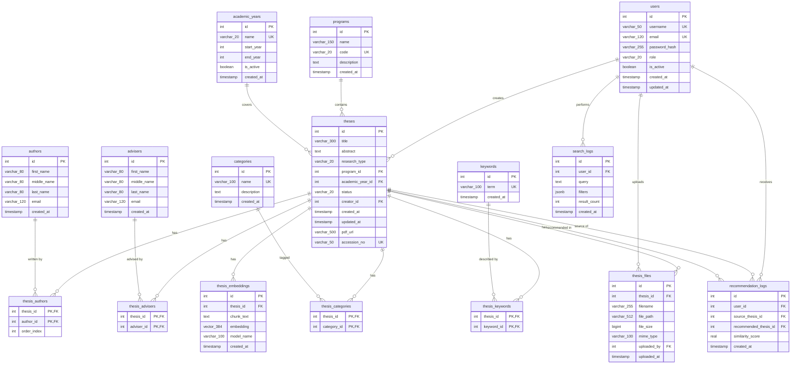

# Entity-Relationship Diagram (ERD)

| Field | Value |
|---|---|
| Document | CScholar — Final ERD (CEIT Scope) |
| Version | 1.0 (Final) |
| Date | 2026-10-09 |
| Status | Approved for Lab Activity 4 submission |
| Source of truth | `db/schema.sql` (16 tables, 18 foreign keys) |
| Tool / notation | Crow's Foot, Mermaid `erDiagram` |

## ERD

## Relationship summary (Crow's Foot)

| # | Parent | Cardinality | Child | Via FK | Notes |
|---|---|---|---|---|---|
| 1 | users | 1 : N | theses | creator_id | ON DELETE SET NULL |
| 2 | programs | 1 : N | theses | program_id | ON DELETE RESTRICT |
| 3 | academic_years | 1 : N | theses | academic_year_id | ON DELETE RESTRICT |
| 4 | theses | 1 : N | thesis_authors | thesis_id | ON DELETE CASCADE |
| 5 | authors | 1 : N | thesis_authors | author_id | ON DELETE CASCADE |
| 6 | theses | 1 : N | thesis_advisers | thesis_id | ON DELETE CASCADE |
| 7 | advisers | 1 : N | thesis_advisers | adviser_id | ON DELETE CASCADE |
| 8 | theses | 1 : N | thesis_categories | thesis_id | ON DELETE CASCADE |
| 9 | categories | 1 : N | thesis_categories | category_id | ON DELETE CASCADE |
| 10 | theses | 1 : N | thesis_keywords | thesis_id | ON DELETE CASCADE |
| 11 | keywords | 1 : N | thesis_keywords | keyword_id | ON DELETE CASCADE |
| 12 | theses | 1 : N | thesis_files | thesis_id | ON DELETE CASCADE |
| 13 | users | 1 : N | thesis_files | uploaded_by | ON DELETE SET NULL |
| 14 | theses | 1 : N | thesis_embeddings | thesis_id | ON DELETE CASCADE |
| 15 | users | 1 : N | search_logs | user_id | ON DELETE SET NULL, nullable |
| 16 | users | 1 : N | recommendation_logs | user_id | ON DELETE SET NULL, nullable |
| 17 | theses | 1 : N | recommendation_logs | source_thesis_id | ON DELETE CASCADE |
| 18 | theses | 1 : N | recommendation_logs | recommended_thesis_id | ON DELETE CASCADE |

**Resolved many-to-many relationships (4):**

| Parent A | Junction table | Parent B | Junction payload |
|---|---|---|---|
| theses | thesis_authors | authors | order_index |
| theses | thesis_advisers | advisers | — |
| theses | thesis_categories | categories | — |
| theses | thesis_keywords | keywords | — |

## Statistics

- Entities: **16** (12 regular + 4 junction)
- Foreign keys: **18**
- Unique constraints: 7 (users.username, users.email, programs.code, academic_years.name, categories.name, keywords.term, theses.accession_no)
- CHECK constraints: 3 (users.role, theses.research_type, theses.status)
- Indexes: 6 (4 B-tree + 1 HNSW vector index + FK index on thesis_embeddings)

## Change log

| Version | Date | Change |
|---|---|---|
| 1.0 | 2026-10-09 | Final ERD released for Lab Activity 4; verified against `db/schema.sql` |
| 1.1 | 2026-11-19 | Added `theses.accession_no` (nullable UNIQUE) for library accession numbers |
